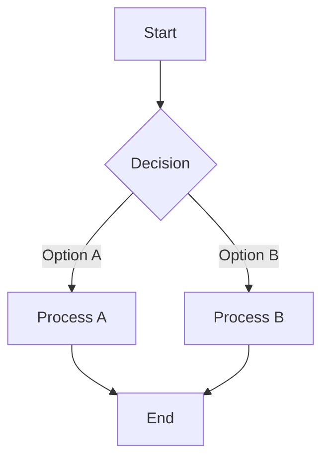
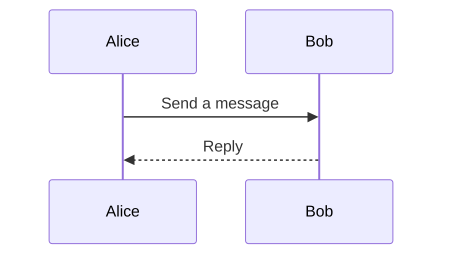

# Markdown

## Syntax

### Basics

**Bold**

~~Strikethrough~~

> Blockquote
>
> - with other elements
> - like list
>
> > With nested content

1. Ordered list
   1. Optionally nested
   2. Like this
2. If numbers are not fixed automatically, use 1. everywhere

---

- Unordered list with multiline content  
  can be achieved by two spaces at every line or trailing \
- Unordered list 2

### Code blocks and literal

`Inline code` with backticks

```python
print('Code')
```

### Line breaks

Non paragraph linebreaks  
Are done  
Via two spaces after the line

Another line break<br><br> via html break

### Table

| Left-Aligned | Center-Aligned | Right-Aligned |
| :----------- | :------------: | ------------: |
| This         |       is       |            an |
| aligned      |      text      |       example |
| example      |     table      |         right |

## Structure

Some paragraph text.

### TOC

In VS Code or Pycharm, there are ways to update Table of Content automatically, never write TOC
manually.

### Newlines

Do not forget to add one empty line before and after every heading.

## Mermaid

Mermaid diagrams are written as text inside a fenced code block labeled `mermaid`.

### Flowchart

Use `flowchart` followed by a direction: `TD` (top down), `LR` (left to right), `BT` (bottom to
top), or `RL` (right to left). Give each node an identifier, then optionally add a shape and label:



Common shapes include `[label]` for a rectangle, `(label)` for a rounded node, `([label])` for a
stadium, and `{label}` for a decision. Connect nodes with `-->`; add text to an edge with
`-- label -->`.

### Sequence diagram

Sequence diagrams show messages between participants from top to bottom:



Use `->>` for a solid message arrow and `-->>` for a dashed return arrow. Participants are created
automatically when first mentioned.
